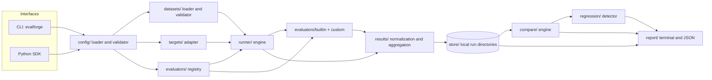

# EvalForge — Architecture

Status: **Proposed — awaiting approval.** Decisions here are recommendations; the
alternatives and open items are in [OPEN_DECISIONS](../OPEN_DECISIONS.md).

Implements the requirements in [PRD](PRD.md) and [TRD](TRD.md).

---

## 1. Architectural summary

EvalForge is a **single Python process library with a thin CLI**. Modules are
separated by responsibility with explicit data contracts between them. Persistence is
local files. There are no services, queues, daemons, or databases in the MVP.

Why this shape:

- The product's core value is correct, traceable results. Fewer moving parts make
  those results easier to verify.
- The public Python API and the CLI must give identical results (PRD-F-027). Both can
  call the same functions only if there is one implementation.
- Local-first and security requirements (PRD-NF-001, PRD-NF-003) are easiest to
  guarantee with no network-facing components.

## 2. Module inventory

Numbering matches the list supplied in the planning brief (items 1–15), extended with
the supporting modules needed to implement it.

| # | Module (proposed package path) | Responsibility | MVP |
|---|---|---|---|
| 1 | `datasets/loader.py` | Read JSON/JSONL files with size and encoding limits; produce case objects and file fingerprints | Yes |
| 2 | `datasets/validator.py` | Validate case structure, IDs, types, limits; collect errors | Yes |
| 3 | `targets/adapter.py` | Target interface, callable adapter, resolution of `module:attribute` | Yes |
| 4 | `runner/engine.py` | Execute cases: timeout, capture, status, evaluator calls, record writing | Yes |
| 5 | `evaluators/registry.py` | Register and resolve evaluator types and custom evaluators; fingerprints | Yes |
| 6 | `evaluators/builtin/*.py` | Deterministic evaluators (exact, normalized, JSON, required fields, rules, latency) | Yes |
| 7 | `evaluators/model_based/` | Interface placeholder only — **no implementation in MVP** | Interface doc only |
| 8 | `results/normalize.py` | Build case results and summaries; apply status aggregation; produce canonical hashes | Yes |
| 9 | `store/` | Local run persistence (manifest, cases, summary), atomic writes, integrity checks | Yes |
| 10 | `compare/engine.py` | Compatibility checks; case categorization; metric comparison | Yes |
| 11 | `regression/detector.py` | Apply thresholds to a comparison; produce typed findings | Yes |
| 12 | `report/` | Terminal, JSON reports; control-character sanitization | Yes (terminal, JSON) |
| 13 | `cli/` | Command-line entry point (`evalforge`) | Yes |
| 14 | `api/` (public surface in `evalforge/__init__.py`) | Python SDK | Yes |
| 15 | Future integrations (for example CI annotations, Markdown export, SQLite store, model-based judges) | — | No (post-MVP) |

Supporting modules:

| Module | Responsibility |
|---|---|
| `config/` | Load and validate `evalforge.toml`; redact secrets for snapshots |
| `models/` | Frozen dataclasses shared by all modules, with validation functions (single source of truth for shapes in DATA_MODELS). No third-party validation library (TRD §3.2; OD-03, OD-15). |
| `redaction/` | Heuristic redaction of strings and structured values (DATA_HANDLING §7); used by store, logging, and exception capture |
| `errors.py` | Exception hierarchy and error codes (DATA_MODELS §9) |
| `canon/` | Canonical JSON serialization and hashing |
| `stats/` | Percentiles and Wilson interval (standard library only) |
| `logging_setup.py` | Logger configuration (library: NullHandler; CLI: handlers) |

## 3. Component diagram



Interfaces depend on the core; the core does not depend on interfaces. No module
depends on `cli/`.

## 4. Data flow

```mermaid
sequenceDiagram
    participant U as User / CI
    participant C as CLI or SDK
    participant V as Config + Dataset validation
    participant R as Runner
    participant T as Target
    participant E as Evaluators
    participant S as Store

    U->>C: evalforge run --config evalforge.toml
    C->>V: load and validate config
    V-->>C: valid config (or exit 2)
    C->>V: load and validate dataset
    V-->>C: cases + fingerprints (or exit 3)
    C->>S: create run directory, write manifest RUNNING
    loop each selected case, in order
        R->>T: call(input copy) under timeout
        alt target ok
            T-->>R: output
        else exception / timeout / invalid output
            T-->>R: ERROR code
        end
        R->>E: evaluate each evaluator (skip rules applied)
        E-->>R: evaluator results
        R->>S: append case result (flush)
    end
    R->>S: write summary, finalize manifest (atomic)
    S-->>C: run handle
    C-->>U: terminal summary; exit code
```

Comparison flow:

```mermaid
sequenceDiagram
    participant U as User / CI
    participant C as CLI or SDK
    participant S as Store
    participant K as Compare engine
    participant D as Regression detector

    U->>C: evalforge compare BASE CAND
    C->>S: load manifests and summaries
    S-->>C: manifests (verify schema, status, integrity)
    C->>K: compatibility check
    alt incompatible and not allowed
        K-->>C: refused (exit 5)
    else compatible or allowed
        K->>S: stream cases.jsonl for both runs
        K-->>D: categorized cases + metrics
        D-->>C: findings
        C-->>U: report; exit 0 or 1
    end
```

## 5. Module boundaries and contracts

### 5.1 Contracts (types, not implementation)

| From → To | Contract | Notes |
|---|---|---|
| Config → Dataset | `DatasetSpec(path, format?)` | Path relative to config file already resolved |
| Dataset → Runner | `Sequence[Case]` plus `DatasetFingerprint` | Immutable objects |
| Config → Target | `TargetSpec(callable_ref or object, name, timeout)` | Resolution performed in targets/ |
| Config → Registry | `EvaluatorSpec(name, type, params)` | Registry validates params with the evaluator's validation function |
| Runner → Target | `call(input: JSONValue) -> JSONValue` | Input is a deep copy |
| Runner → Evaluator | `evaluate(case: Case, output: JSONValue, duration_ms: float) -> EvaluatorResult` | Pure; inputs copied |
| Runner → Normalize | `TargetResult`, `list[EvaluatorResult]` | Normalize applies aggregation (EVALUATION_METHODOLOGY §3.3) |
| Normalize → Store | `CaseResult` (append) | Immutable after write |
| Store → Compare | `RunHandle` with `manifest`, `iter_cases()`, `summary` | Read-only |
| Compare → Regression | `Comparison` (categories, metrics, compatibility) | Immutable |
| Regression → Report | `list[RegressionFinding]` | |

### 5.2 Boundary rules

1. Only `runner/` calls targets and evaluators.
2. Only `store/` touches the filesystem for run artifacts. `config/` and `datasets/`
   read input files; `report/` writes only to paths given by the user.
3. Only `cli/` performs terminal I/O and maps exceptions to exit codes.
4. `compare/` and `regression/` never read case inputs or outputs from disk except
   through `store/` iterators.
5. Evaluator code never imports `store/`, `cli/`, or `report/`.
6. Canonicalization is implemented once in `canon/` and used by datasets, runner, and
   compare, so that hashes agree across modules.

## 6. Execution lifecycle

```
INIT → CONFIG_VALID → DATASET_VALID → RUN_CREATED(RUNNING) → CASE_LOOP → FINALIZING → {COMPLETED | ABORTED | FAILED}
```

| State | Entry condition | Exit actions |
|---|---|---|
| CONFIG_VALID | Config loads and validates | — |
| DATASET_VALID | Dataset validates; no errors | — |
| RUN_CREATED | Run directory created with exclusive lock; manifest written as RUNNING | Lock file created (TRD-121) |
| CASE_LOOP | For each selected case | Case record appended |
| FINALIZING | Loop ends or interrupted | Summary written; `cases_sha256` and `summary_sha256` computed; manifest replaced atomically; lock removed |
| COMPLETED / ABORTED / FAILED | Terminal | Exit code chosen by CLI |

Interrupt handling: a `KeyboardInterrupt` during a case moves the engine to FINALIZING
after the grace period (TRD-103). Remaining cases are recorded as not executed in the
summary count, not written as case records (to avoid inventing results).

Crash handling: if the process dies, the manifest stays `RUNNING` and the lock file
stays. `inspect` reports the run as incomplete; `compare` refuses it (TRD-130).

## 7. Error propagation

| Layer | Error type | Handling | Surfaces as |
|---|---|---|---|
| Target code | Any exception | Caught in runner; `TARGET_EXCEPTION` | Case ERROR |
| Target timing | Timeout | Runner timer; `TARGET_TIMEOUT` | Case ERROR |
| Target output | Non-serializable | Canonicalization check; `TARGET_OUTPUT_INVALID` | Case ERROR |
| Evaluator code | Any exception | Caught; `EVALUATOR_EXCEPTION` | Evaluator ERROR → case ERROR |
| Evaluator return | Malformed | Validated; `EVALUATOR_RESULT_INVALID` | Evaluator ERROR |
| Dataset | Invalid content | Collected by validator | Exit 3 before run |
| Config | Invalid | Collected by validator | Exit 2 before run |
| Storage | Write/lock/read failure | Raised as `StorageError` | Run FAILED or refused; exit 4 |
| Engine bug | Unexpected exception | Caught at top-level engine boundary; `ENGINE_ERROR` | Run FAILED; exit 4 |
| Compare | Incompatible inputs | Refusal object, not an exception path for the user | Exit 5 |

Principle: exceptions are converted to typed results at the first boundary that can
classify them. No raw traceback reaches users at default verbosity.

## 8. Configuration

- Single file `evalforge.toml` (OD-04), validated by configuration validation functions (stdlib `tomllib` for parsing).
- Precedence (proposed): CLI option > configuration file > built-in default. The Python
  API takes explicit arguments that override the file when both are used.
- No environment-variable interpolation (TRD-183).
- Override flags (`--allow-dataset-change`, `--allow-evaluator-change`, `--strict`) exist only as CLI options or explicit API arguments, never as configuration keys (ARTIFACT_INTEGRITY §6.2).
- The configuration snapshot is taken at run creation and stored with secrets redacted.

## 9. Persistence

| Aspect | Decision |
|---|---|
| Format | JSON (manifest, summary) and JSON Lines (cases) |
| Location | `.evalforge/runs/<run_id>/` relative to config file (OD-11) |
| Atomicity | Temp file + `os.replace` for manifest and summary; append-with-flush for cases |
| Integrity | `cases_sha256` and `summary_sha256` in manifest; consistency check only, not tamper evidence (ARTIFACT_INTEGRITY) |
| Locking | Exclusive lock file per run directory |
| Retention | Never automatic; user deletes runs (documented) |
| Migration | Schema major versions are explicit; no in-place migration in MVP |

Why not SQLite now: it adds a dependency-free but still new code path with transactions,
locking, and migrations. JSON files are inspectable, diffable in version control, and
simple to validate. SQLite is a documented post-MVP option (PRD-F-102). Decided: OD-05 (approved; SQLite deferred).

## 10. Extensibility

### 10.1 Custom evaluators

- Implement the evaluator interface (TRD-080). Register via configuration
  (`type = "custom"`, `callable = "module:Class"`) or API.
- Fingerprint includes source file hash (TRD-085). Changing the file changes the
  fingerprint and triggers `EVALUATOR_CHANGED` in comparisons.
- Trusted code. Documented in SECURITY (THR-004).

### 10.2 Custom targets

- Implement the target interface (TRD-060): a callable or an object with `name` and
  `__call__`.
- Adapters for other frameworks are user code. Core ships only the callable adapter in MVP.

### 10.3 Versioning of extension points

- Evaluator and target interfaces carry an `interface_version` constant (proposed
  `"1"`), checked at registration. Breaking changes increment it.
- Built-in evaluator `version` strings are recorded in manifests so that behaviour
  changes across EvalForge versions are visible.

### 10.4 Optional provider integrations (post-MVP)

- Provided only as optional extras, behind the same evaluator interface, with the
  disclosure and cost rules in EVALUATION_METHODOLOGY §13.
- Core package must import without any provider SDK installed (verified by test).

## 11. Concurrency and timeouts

- MVP: single-threaded case loop. Each target call runs in a worker thread so that the
  runner can stop waiting after the timeout.
- **Timeouts are best-effort.** When the timeout expires, the runner records
  `TARGET_TIMEOUT` and continues. Python cannot forcibly stop a thread, so the target may
  keep running, consume CPU and memory, and perform side effects. The manifest records
  `counts.threads_possibly_running` (DATA_MODELS §6). Documentation states this limitation
  (SECURITY §10).
- EvalForge does not claim that arbitrary Python execution can be reliably terminated.
- Parallel case execution is post-MVP (PRD-F-104).

### 11.1 Process isolation: feasibility analysis

Question investigated: can callable targets run in a subprocess, with timeouts enforced by
terminating the process, and what does that cost?

Basis: documented behaviour of Python's `multiprocessing` and the operating systems named
in the TRD. **This analysis was not tested empirically in this phase.** Any claim here must
be validated by a time-boxed spike before it is relied on.

| Factor | Analysis | Consequence |
|---|---|---|
| Transferring the target | With `spawn` (default on Windows and macOS), the callable is pickled or re-imported in the child. Top-level functions and classes can be referenced by name. Lambdas, closures, and objects holding open resources cannot be pickled. | Isolation would be limited to `module:attribute` references, or to picklable callables. This narrows the Python API. |
| Transferring inputs and outputs | Inputs are JSON values and outputs must be JSON-serializable (TRD-062). Transfer can use JSON over a pipe. | The existing JSON contract is the wire format. No pickling of outputs is needed. |
| Startup cost | A new interpreter and a module import per process. Reusing a worker across cases is faster but lets target state leak between cases. | Fresh process per case is slow. Reuse weakens reproducibility and must be documented as a state caveat. |
| Portability | `fork` is unavailable on Windows and is unsafe on macOS with some libraries. `spawn` requires user scripts to guard their entry point with `if __name__ == "__main__":`. | Behaviour differs by OS and must be tested on all three. The CLI can avoid the guard requirement because its worker is an EvalForge module; the Python API cannot. |
| Termination | `terminate()` sends SIGTERM on POSIX and calls TerminateProcess on Windows. Processes started by the target may survive. | Termination is reliable only for the direct child. Orphan cleanup is not guaranteed. |
| Resource limits | CPU and memory limits are available through the `resource` module on POSIX only. Windows needs job objects. | Resource limits would be platform-specific and are out of MVP scope. |
| Error propagation | Exception objects may not pickle, so the child must send type name and truncated message as strings (DATA_HANDLING §4). A crash (segfault, `os._exit`) appears as a non-zero exit with no result. | Needs a new reason code, `TARGET_CRASHED` (proposed), and more tests. |
| Output capture | Target stdout and stderr can corrupt the protocol unless captured or discarded. | Needs a defined policy for target printing. |
| Security | A subprocess has the same user, filesystem, network, and inherited environment as the parent unless further constrained. Inherited environment variables reach the child, which may include credentials. | Isolation is a fault boundary, not a sandbox. It is not a security control, and no security claim is made for it. |
| Testing | Requires the three-OS matrix, fault injection, and timing tolerance. | Substantial test effort. |

**Recommendation**

1. **Do not include process isolation in the MVP.** Keep thread-based, best-effort timeouts,
   documented as such (done in SECURITY §10, ARCHITECTURE §11, TRD §5.3).
2. **Milestone 13 delivers a written decision only.** It confirms or corrects the analysis
   above. Any spike requires separate approval.
3. **If the owner approves, a post-MVP milestone M17** would add opt-in isolation for
   `module:attribute` targets only, with a JSON protocol, a fresh process per case by default,
   documented state semantics, crash detection, and cross-platform tests.
4. Isolation would still execute trusted code. It would not change the trust model in
   THREAT_MODEL §1.3.

## 12. Performance considerations

- Dataset loading streams JSONL lines; JSON arrays are parsed with a size cap.
- Case results are written as they complete, so memory does not grow with run length.
- Comparison streams both `cases.jsonl` files in sorted order (both are written in dataset
  order; comparison sorts by case ID via an index built from the smaller file, or an
  external merge if necessary). The approach and its memory bound are to be measured
  in milestone 10.
- Performance targets are in TRD §16 and are not yet measured.

## 13. Security architecture

Full analysis in [THREAT_MODEL](THREAT_MODEL.md). Architectural controls:

| Control | Where |
|---|---|
| No network code in core | Whole package; verified by test (PRD-NF-001) |
| Dataset parsed as data | `datasets/loader.py` (no eval/pickle/YAML) |
| Resource limits | `datasets/loader.py`, `evaluators/builtin/rule_based.py` (regex length) |
| Output sanitization for terminal | `report/terminal.py` |
| No secrets in artifacts | `config/` redaction; `store/` writes only allowed fields |
| Path control | `store/` and `report/` only write to resolved, user-specified locations |
| Trust boundary for code | Targets and custom evaluators loaded only from config or API (TRD-217) |

## 14. Dependency structure

Runtime dependencies in the MVP: **none beyond the Python standard library**, if OD-03 and
OD-15 are approved. This is a change from the earlier proposal of Pydantic
and Typer. It is recorded in ARCHITECTURE §16 (AD-009) and TRD §3.2. The reason: TRD-003
requires a pure-Python package, and Pydantic's core is a compiled extension; the MVP also
needs few validation or CLI features that the standard library cannot handle. Development
dependencies (`pytest`, `ruff`, `mypy`, `pip-audit`; uv manages the environment) are not installed for
users.

Dependency direction is enforced by a test that imports each module in isolation
(TST-SEC-005).

## 15. Alternatives considered

| Decision | Chosen (proposed) | Alternatives | Reason for choice |
|---|---|---|---|
| Structure | Modular library + CLI | Microservices; hosted API | No requirement justifies distributed infrastructure; local-first requirement |
| Persistence | JSON/JSONL run directories | SQLite; full database | Inspectable, diffable, no extra dependency; see §9 |
| Config format | TOML (`tomllib`) | YAML (needs a parser dependency and careful safe-loading); JSON (no comments); Python config (executes code) | Standard library on 3.11+; no code execution in configuration |
| Validation | Frozen dataclasses with validation functions | Pydantic v2 (compiled core, conflicts with TRD-003); attrs; Cerberus | Zero runtime dependencies; explicit error paths; more validation code and tests (cost accepted) |
| CLI | `argparse` (standard library) | Typer (adds transitive dependencies); Click | Zero dependencies; more parser code but fewer supply-chain paths (THR-014) |
| Timeouts | Worker thread, best-effort | Subprocess per call (§11.1); signal-based (`SIGALRM`, POSIX only) | Thread works on all platforms; subprocess deferred per §11.1 |
| Concurrency | Sequential | Thread pool; async | Determinism and simplicity; parallelism post-MVP |
| Hashing | SHA-256 over canonical JSON for identity; SHA-256 over file bytes for artifact consistency | Hash of raw file only | Canonical hashes survive formatting changes; file hashes detect byte-level corruption (ARTIFACT_INTEGRITY) |
| Statistics | Standard library | numpy/scipy | Counts, percentiles, and Wilson interval are simple |
| Evaluator aggregation | Status rules, no averaged score | Weighted average | Averages hide failing checks (EVALUATION_METHODOLOGY §12) |
| Stored content | `io_mode` = full, hashes, or none; redaction on by default | Always store full content; always hashes | User-controlled exposure; see DATA_HANDLING §3 |

## 16. Architectural decision log

| ID | Decision | Status |
|---|---|---|
| AD-001 | Single library with thin CLI; no services | Proposed |
| AD-002 | Local JSON/JSONL persistence; SQLite deferred | Approved (OD-05) |
| AD-003 | Sequential execution with best-effort thread timeouts; no process isolation in MVP | Approved (OD-06); isolation reassessed in M13 |
| AD-004 | Five-status model with defined aggregation | Proposed |
| AD-005 | Comparison refuses incompatible inputs by default; overrides explicit and visible | Proposed (OD-09, OD-28) |
| AD-006 | Custom targets and evaluators are trusted code; datasets are data | Proposed |
| AD-007 | TOML configuration; no environment interpolation | Approved (OD-04) |
| AD-008 | Model-based evaluators are out of MVP and behind an interface only | Proposed |
| AD-009 | Zero runtime dependencies beyond the standard library (replaces Pydantic and Typer proposals) | Approved (OD-03, OD-15) |
| AD-012 | Tooling: argparse, Hatchling, uv, and a required `mypy --strict` gate | Approved (OD-03, OD-15) |
| AD-013 | External contributions require DCO sign-off | Approved (OD-31) |
| AD-014 | Package name is provisional for local use; publication is blocked until checks complete | Approved with conditions (OD-10, G-2) |
| AD-010 | Stored content controlled by `io_mode` and redaction; redaction documented as heuristic | Proposed (OD-12, OD-21, OD-27) |
| AD-011 | Artifact hashes are consistency checks, not tamper evidence | Proposed (ARTIFACT_INTEGRITY) |

## 17. Known limitations

- Timed-out target threads may continue running (§11).
- Trusted-code loading means a malicious configuration or evaluator can do anything Python can.
- Artifact hashes cannot detect deliberate rewriting of a run directory (ARTIFACT_INTEGRITY §5).
- Redaction is heuristic and incomplete (DATA_HANDLING §7.4).
- JSON persistence is not safe for concurrent writers beyond the run-directory lock.
- Comparison memory behaviour is not yet measured.
- Windows file-locking tests are part of milestone 7 (IMPLEMENTATION_PLAN).
- Path-based fingerprints are not stable across machines; content hashes are.
